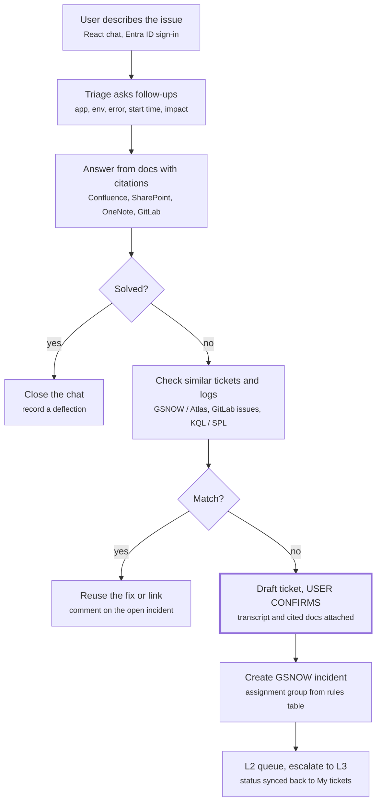
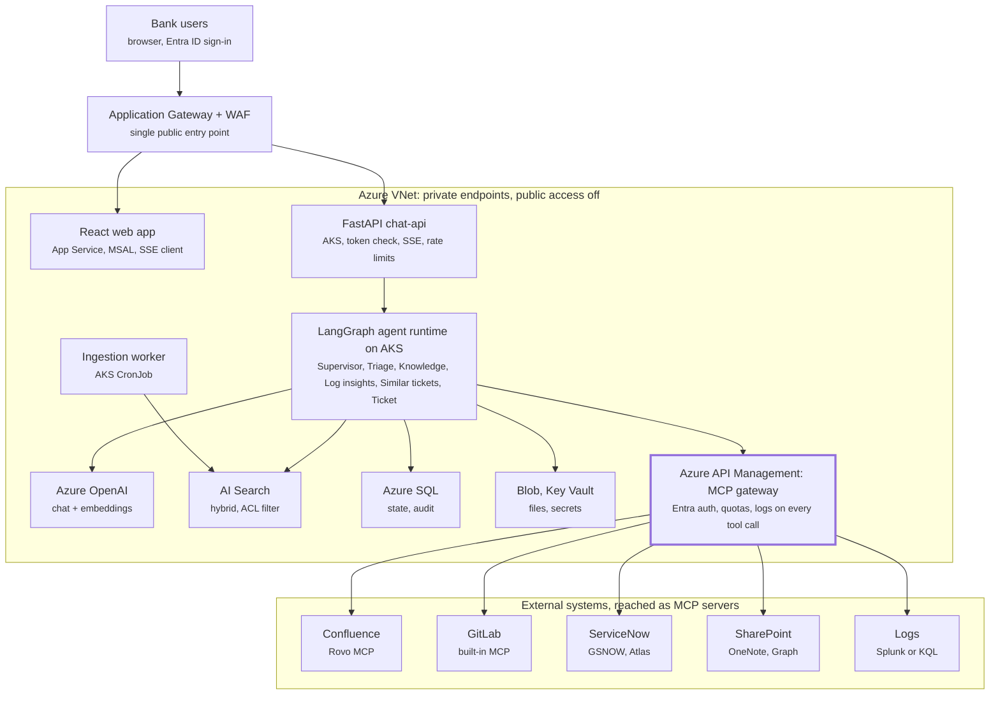

# L3 Support Agent — Architecture

Nov 11, 2026 · DJ

## Summary

Build the L3 support assistant as a React web app over a Python LangGraph supervisor with five specialist sub-agents on Azure. It answers from indexed docs with citations, asks follow-ups until the issue is clear, checks for similar tickets, and only then creates a GSNOW ticket routed to the L2/L3 queue — after the user confirms.

| Area | Decision | Why |
| --- | --- | --- |
| Frontend | React + TypeScript (Vite), Fluent UI, MSAL sign-in, answers streamed over SSE | Fits Microsoft/Entra estate; streaming feels fast |
| API | FastAPI (Python) on AKS | Same language as LangGraph; you already run AKS |
| Orchestration | LangGraph: supervisor + sub-agents; ticket creation as a fixed sub-graph with human approval | LLM decides what to look up; code decides what to write |
| Models | Azure OpenAI (bank-approved chat model + text-embedding-3-large) via private endpoint | Approved stack |
| Retrieval | Azure AI Search hybrid (keyword + vector + semantic ranker) with per-document access filters | Fast, permission-aware, one index for all sources |
| Tools | MCP servers (Atlassian, GitLab, ServiceNow, Azure Monitor/Splunk, in-house Graph) behind Azure API Management | One place for auth, quotas, logs |
| State | Azure SQL / SQL MI (MS SQL): conversations, checkpoints, tickets, audit | Bank standard DB |
| Ticketing | ServiceNow (GSNOW / Atlas) via MCP; routing from a rules table, not the LLM | Predictable assignment |
| Security | Entra ID + on-behalf-of tokens, private networking, Prompt Shields, OWASP LLM + Agentic Top 10 controls | Bank-grade controls |

## End-to-end flow



The agent answers first and only escalates when docs and past tickets can't solve it; the confirm step is the one place a human must approve before anything is written to GSNOW.

## Architecture on Azure



Everything runs inside one VNet with private endpoints; the only way out to Confluence, GitLab, ServiceNow, SharePoint and logs is API Management. The ingestion worker crawls the same sources into AI Search; App Insights / Log Analytics collect traces from every component.

## Frontend (React web app)

A single-page React + TypeScript app signs users in with Entra ID (MSAL) and streams answers from the API. The browser holds tokens only — never API keys.

| Screen | What the user sees | Key behaviour |
| --- | --- | --- |
| Chat | Streaming answer, citation chips (source, page, last updated), thumbs up/down | "Still stuck? Raise a ticket" button always visible |
| Clarify | Follow-up questions as quick-reply chips (app, environment, error text, when it started, impact) | Max 3 clarify turns, then answer or offer ticket |
| Ticket draft | Prefilled short description, description, app/CI, impact, urgency; attachments; "Similar tickets" list | User must press Submit; can pick "This solves it" or "Same as open INC" |
| My tickets | Status of tickets created through the assistant | Synced from ServiceNow |
| Admin (L3 team) | Feedback, unanswered questions (KB gaps), eval scores | App role `L3.Admin` only |

Stack: React, TypeScript, Vite, Fluent UI React v9, TanStack Query, MSAL React, SSE over `fetch` streaming. File uploads go to Blob Storage through a short-lived SAS issued by the API, with Defender for Storage malware scanning before the agent can read them. Target WCAG 2.1 AA. Host on App Service (or Static Web Apps) behind Application Gateway with WAF.

## Backend & agents

One FastAPI service hosts a LangGraph graph: a supervisor routes each turn to specialist sub-agents, and ticket creation runs as a fixed sub-graph that pauses for the user's approval (`interrupt`) before anything is written.

### Services

| Service | Runtime | Responsibility |
| --- | --- | --- |
| chat-api | FastAPI on AKS | Entra token validation, sessions, SSE streaming, rate limits |
| agent-runtime | LangGraph (same pod as chat-api at first) | Graph execution, checkpoints in MS SQL |
| ingestion-worker | AKS CronJob or Azure Functions | Pull Confluence, SharePoint, OneNote, GitLab, tickets → chunk → embed → index |
| mcp-servers | AKS / Container Apps, fronted by APIM | Tool access to Atlassian, GitLab, ServiceNow, logs, Graph |
| eval-runner | CI job | Offline evals that gate every release |

### Agents

| Agent | Job | Tools | Can write? |
| --- | --- | --- | --- |
| Supervisor | Classify intent, pick next agent, decide when to stop | None | No |
| Triage | Fill slots: app/CI, environment, error, start time, impact; ask follow-ups | CMDB lookup | No |
| Knowledge | Search all indexes, answer with citations, score groundedness | `search_kb`, `get_confluence_page`, `get_sharepoint_doc` | No |
| Log insights | Run pre-approved KQL/SPL templates for the app and time window | `query_logs` (templated only) | No |
| Similar tickets | Find matching GSNOW/Atlas incidents and GitLab issues | `search_tickets`, `search_gitlab_issues` | No |
| Ticket | Draft ticket, map assignment group, create after approval | `create_incident`, `add_attachment`, `add_comment` | Yes, after user confirms |

### Turn flow

1. Intake: redact PII, run Prompt Shields on the message.
2. Triage loop until the slots are filled or 3 clarify turns pass.
3. Knowledge agent answers with citations; a groundedness check decides confidence.
4. Low confidence or user says it didn't help → optional log insights → similar tickets.
5. User picks "This solves it" (end), "Same as open ticket" (link), or "Raise ticket" → draft → approval interrupt → create → return the INC number.

Harness basics: `recursion_limit` per turn, per-tool timeouts, retries with backoff, and a fallback path that always ends in "raise a ticket" instead of a guess.

## Knowledge & retrieval

Index every source into Azure AI Search ahead of time and search it hybrid (keyword + vector + semantic ranker); call live tools only for fresh, single-item detail such as one Confluence page or one open incident.

| Source | Ingest via | Index | Refresh | Access filter |
| --- | --- | --- | --- | --- |
| Confluence | Confluence REST API (or Rovo MCP if Cloud) | `kb-docs` | Nightly + on page-update webhook | Space permissions → Entra group ids |
| SharePoint / Word / PDF | AI Search indexed SharePoint knowledge source (preview) or Graph crawler | `kb-docs` | Nightly | SharePoint ACLs |
| OneNote | Microsoft Graph OneNote API (custom crawler) | `kb-docs` | Nightly | Notebook ACLs |
| GitLab issues, wikis, READMEs | GitLab REST API | `kb-code` | Nightly | Project membership |
| GSNOW / Atlas resolved tickets | ServiceNow Table API: short description, description, resolution notes, CI, assignment group | `kb-tickets` | Hourly | Redact PII; scope by app |

- **Chunking (starting point):** split on headings, ~500–800 tokens, small overlap; keep tables whole.
- **Metadata per chunk:** source, url, app/CI, environment, owner, last_updated, `acl_groups`.
- **Query:** hybrid search → top 20 → semantic rerank → top 5 into the prompt, always filtered by the signed-in user's groups (security trimming).
- **Answer rule:** every claim cites a chunk; if no chunk supports it, say so and offer a ticket — never fill gaps from model memory.
- **Later option:** Azure AI Search agentic retrieval (knowledge bases that query several knowledge sources in one call) can replace the custom retriever once its features are GA for your sources.

## MCP servers & tools

Use the vendor's official MCP server where one exists, write thin in-house FastMCP servers for the rest, and put every server behind Azure API Management so auth, quotas and logs sit in one place.

| System | MCP option | Notes for the bank |
| --- | --- | --- |
| Confluence (+ Jira / JSM) | [Atlassian Rovo MCP Server](https://github.com/atlassian/atlassian-mcp-server) — official, cloud-hosted, OAuth 2.1 or API token, respects user permissions | Cloud only. If Confluence is Data Center, build an in-house MCP over its REST API |
| GitLab | [GitLab built-in MCP](https://mcpplaygroundonline.com/mcp-servers/gitlab) at `/api/v4/mcp`, OAuth `mcp` scope or PAT | Self-managed needs GitLab 18.7+ ([source](https://toolradar.com/tools/gitlab-mcp-server)) |
| ServiceNow (GSNOW / Atlas) | Native [MCP Server Console](https://www.servicenow.com/docs/r/release-notes/mcp-server-console-rn.html) (Zurich+, Now Assist SKU, OAuth 2.0) or an in-house server on the Table API | Native path is governed but each call uses Now Assist "assists"; in-house keeps 4–5 narrow tools |
| SharePoint / Word | No first-party Microsoft MCP; community servers exist | Prefer AI Search indexing + an in-house Graph `get_document` tool |
| OneNote | [No official MCP](https://learn.microsoft.com/en-us/answers/questions/5903640/question-regarding-onenote-mcp); Microsoft points to the Graph OneNote API | In-house wrapper |
| Azure Monitor / Log Analytics | [Azure MCP Server](https://learn.microsoft.com/en-us/azure/developer/azure-mcp-server/tools/monitor), monitor namespace (KQL queries) | Read-only; wrap with templated queries |
| Splunk (if that is the log platform) | [Official Splunk MCP Server](https://help.splunk.com/en/splunk-enterprise/mcp-server-for-splunk-platform) app, RBAC-aware | Read-only service account |

**Tool design rules**

- Narrow, task-shaped tools (`search_tickets`, `create_incident`) — never a raw "call any Table API" tool.
- Read-only by default; only the Ticket agent holds write tools, and they require an approval token from the confirm step.
- On-behalf-of user tokens for docs and tickets so the agent sees exactly what the user can see.
- [APIM](https://learn.microsoft.com/en-us/azure/api-management/mcp-server-overview) can expose a REST API as an MCP server or proxy an existing one; it supports MCP tools but not resources or prompts. Register all servers in Azure API Center as the internal MCP registry.

## Ticketing flow

Before any ticket is created the assistant checks for duplicates and similar resolved tickets; a new GSNOW incident is created only after the user presses Submit, and its assignment group comes from a rules table.

1. **Trigger:** user clicks "Raise ticket", says they want a human, or confidence stays low after two answer attempts.
2. **Draft:** the Ticket agent fills short description, description (problem, steps, error text, environment, start time), app/CI, impact, urgency and caller from the triage slots. It attaches the chat transcript, cited docs and user uploads.
3. **Similar match (live, as the user edits):** vector search on `kb-tickets` + open ServiceNow incidents on the same CI + open GitLab issues. Show the top 5 with status and a one-line resolution.
4. **User decides:**
    - "This solves it" → close the chat, record a deflection.
    - "Same as this open ticket" → add a comment / affected user to that incident instead of a duplicate.
    - "Create new" → step 5.
5. **Create:** `create_incident` with an idempotency key (draft id), then `add_attachment`; return the INC number in chat.
6. **Route:** `assignment_rules` maps app/CI + category to the L2 group; L2 escalates to the L3 group inside ServiceNow. If no rule matches, the ticket goes to a triage group — the LLM only suggests, never decides.
7. **Close the loop:** resolved tickets flow back into `kb-tickets` hourly; L3 can promote a fix to a Confluence KB article, which the next user's question then finds.

## Data model (MS SQL)

Azure SQL Database (or SQL Managed Instance) holds conversations, agent checkpoints, ticket links, routing rules, feedback and audit; Blob Storage holds files; AI Search holds chunks. Content is redacted before it is stored.

| Table | Key columns | Purpose |
| --- | --- | --- |
| `users` | user_id (Entra oid), upn, department | Identity cache |
| `conversations` | conversation_id, user_id, app_ci, status, outcome (answered / ticket / linked / abandoned), created_at | One support session |
| `messages` | message_id, conversation_id, role, content_redacted, prompt_version, tokens_in, tokens_out | Transcript |
| `citations` | message_id, source, doc_url, chunk_id, score | Which docs backed each answer |
| `tool_calls` | call_id, message_id, agent, tool, args_hash, status, latency_ms | Audit of every tool use |
| `checkpoints`, `checkpoint_writes` | thread_id, checkpoint_id, blob | LangGraph state |
| `ticket_drafts` | draft_id, conversation_id, fields_json, attachments_json, similar_json, state | Draft before submit |
| `tickets` | ticket_id, system (GSNOW / Atlas / GitLab), external_number, assignment_group, status | Link to the external ticket |
| `assignment_rules` | app_ci, category, environment, l2_group, l3_group | Deterministic routing |
| `feedback` | message_id, rating, reason, comment | Answer quality |
| `ingestion_runs` | source, started_at, docs_indexed, errors | Ingestion health |
| `eval_runs` | run_id, dataset, metrics_json, passed | Release gate |

For the LangGraph checkpointer on MS SQL there are community packages ([langgraph-checkpoint-mssql](https://pypi.org/project/langgraph-checkpoint-mssql/), [langgraph-azure-sql-db-checkpoint](https://pypi.org/project/langgraph-azure-sql-db-checkpoint/)); both are small and early-stage, so vet them or write your own saver against the same two tables.

## Security & compliance

Treat every doc, ticket and log line as untrusted input, give the agent the user's own permissions and no more, and keep every hop on private networking.

| Layer | Controls |
| --- | --- |
| Identity | Entra ID SSO + Conditional Access; app roles (User, L2, L3.Admin); on-behalf-of tokens to docs and tickets; managed identities between Azure services; third-party tokens in Key Vault |
| Network | App Gateway + WAF in front; VNet integration; private endpoints for Azure OpenAI, AI Search, SQL, Storage, Key Vault; public access off; egress firewall allowlist to Confluence, GitLab, ServiceNow |
| Data | PII redaction before the LLM and before logging; no client account data in prompts; encryption at rest with customer-managed keys; retention per records policy |
| Prompt injection | [Prompt Shields](https://learn.microsoft.com/EN-US/AZURE/ai-services/content-safety/concepts/jailbreak-detection) on user input and on retrieved documents; retrieved text wrapped in delimiters; tools never act on instructions found in content |
| Agency | Read-only tools by default; only the Ticket agent writes, after approval; max tool calls per turn; feature-flag kill switch |
| Output | Sanitised markdown; citations must resolve to indexed docs; no auto-opened links |
| Audit | Prompts, tool calls, citations, tickets logged to SQL + Log Analytics with one correlation id; APIM logs all MCP traffic |
| Governance | Model risk review, DPIA, threat model, red team before go-live |

**OWASP mapping** ([LLM Top 10 2025](https://genai.owasp.org/resource/owasp-top-10-for-llm-applications-2025/), [Agentic Top 10 2026](https://genai.owasp.org/resource/owasp-top-10-for-agentic-application))

| Risk | Control in this design |
| --- | --- |
| LLM01 Prompt injection / ASI01 Goal hijack | Prompt Shields, delimiters, write tools gated by user approval |
| LLM02 Sensitive information disclosure | Security trimming in search, PII redaction |
| LLM06 Excessive agency | Read-only default, human-in-the-loop on create |
| LLM07 System prompt leakage | No secrets or routing rules in prompts |
| LLM08 Vector and embedding weaknesses | ACL metadata on every chunk, separate indexes per sensitivity |
| LLM09 Misinformation | Cite-or-decline rule, groundedness check |
| LLM10 Unbounded consumption | APIM token quotas, per-user rate limits, recursion limit |

## Context engineering & harness

Each sub-agent gets a small, purpose-built context; the shared truth lives in the graph state, not in an ever-growing chat history.

**ReAct or loops?** Both, at different levels. The top level is a LangGraph state machine with fixed edges (triage → answer → similar → ticket), so the path is predictable and auditable. Inside, the Knowledge, Log and Similar-ticket agents are small ReAct tool loops capped at a few steps each. The Ticket agent is not ReAct at all: it fills a Pydantic schema, then code calls the API.

- **State schema:** user, slots {app_ci, env, error_text, started_at, impact}, retrieved_chunks, answer, confidence, similar_tickets, ticket_draft, clarify_turns.
- **Prompts as code:** versioned files in `prompts/`, loaded by name; the version is stored on every message.
- **Context budget per call:** system prompt + slots + top 5 chunks + a running summary of older turns + the last few turns verbatim.
- **Memory:** no free-form agent memory at launch; the team's memory is the KB and resolved tickets, which are governed and searchable.
- **Structured outputs:** router decision, slots and ticket draft are Pydantic models, so the LLM cannot invent fields.
- **Guardrail nodes:** pre (Prompt Shields, PII redaction) and post (groundedness, citation validator, PII scan on output).
- **Observability:** OpenTelemetry traces into Application Insights; add a self-hosted agent tracer (e.g. Arize Phoenix) if the bank approves it.
- **Evals that gate releases:** retrieval recall@5, groundedness, citation accuracy, routing accuracy, ticket-field accuracy, and deflection rate on the golden set.

## Test data & testing

Build a synthetic but realistic dataset first, so the whole flow runs end to end in dev without any production or client data. Sizes below are suggested starting points.

| Dataset | Contents | Start size |
| --- | --- | --- |
| Fake apps | 3 fictional apps mirroring real domains: a payments/disbursements app, a wealth-planning app, a branch request tool | 3 apps, 1 CMDB entry each |
| Synthetic KB | Runbooks, FAQs, known errors in a test Confluence space, a test SharePoint site and a OneNote notebook | ~100 pages |
| Synthetic tickets | Resolved + open incidents with realistic descriptions and resolution notes in a ServiceNow dev instance (or PDI) | ~300 resolved, ~30 open |
| Logs | Generated AKS / App Service logs with injected errors in a test Log Analytics workspace | 7 days of logs |
| Golden set | Question → expected answer, expected source, expected action (answer / link / ticket) | ~150 cases |
| Adversarial set | Injected instructions inside docs, PII-leak prompts, questions about docs the user can't access | ~50 cases |

Testing levels:

1. Unit tests for tools and nodes with mocked MCP responses.
2. Contract tests for each MCP server against its sandbox.
3. Graph tests with a fake LLM to check routing and the approval interrupt.
4. Retrieval and answer evals on the golden set (run in CI).
5. End-to-end UI tests with Playwright.
6. Load test with Azure Load Testing.
7. Red team with PyRIT plus the adversarial set; then UAT with one L2 team.

## Repo, CI/CD & environments

One GitLab monorepo, GitLab CI building containers into Azure Container Registry and deploying with Helm to AKS through dev → test → prod with approval gates.

```text
l3-support-agent/
  apps/web/              React + TypeScript UI
  services/api/          FastAPI: auth, sessions, SSE
  services/agent/        LangGraph graph, agents, state, guardrails
    prompts/             versioned prompt files
  services/ingestion/    crawlers, chunking, indexing jobs
  mcp/                   in-house MCP servers (servicenow, graph-docs, onenote, logs)
  infra/                 Bicep or Terraform, Helm charts
  evals/                 golden + adversarial sets, eval runner
  testdata/              synthetic KB, tickets, logs generators
  tests/                 unit, contract, e2e
```

| Environment | Data | Gate to promote |
| --- | --- | --- |
| dev | Synthetic only | Unit + graph tests green |
| test / UAT | Synthetic + masked samples | Eval thresholds met, SAST / dependency / container scans clean |
| prod | Real | Change approval, security sign-off |

## Phased delivery

Ship answers first, ticketing second, extra sources third; each phase ends at a gate the team can test. Durations are left open until team size is known.

| Phase | Scope | Exit gate |
| --- | --- | --- |
| 0. Foundations | Azure landing zone, private networking, Entra app + roles, APIM, SQL, AI Search, synthetic data | Security architecture review passed |
| 1. Answer MVP | Chat UI, triage, Knowledge agent over Confluence + SharePoint, citations, feedback | Golden-set accuracy and groundedness meet targets agreed with L3 |
| 2. Ticketing | Similar-ticket search, draft + approval, ServiceNow create, assignment rules, My tickets | Zero creates without approval in tests; routing correct on the test set |
| 3. More sources | OneNote, GitLab, Log insights agent | Retrieval recall holds with the larger index |
| 4. Hardening + pilot | Red team, load test, model risk review, pilot with one app team | Sign-offs; pilot deflection and CSAT measured |
| 5. Scale | More apps, L3 admin dashboard, KB-gap loop into Confluence | Ongoing |

## Open questions

- [ ] Confluence: Cloud or Data Center? (Cloud → Rovo MCP; Data Center → in-house MCP)
- [ ] GSNOW and Atlas: both ServiceNow? Which release, and is Now Assist licensed (native MCP)?
- [ ] Logs ("LG team / big logs"): Splunk, Azure Log Analytics, or ELK?
- [ ] Which Azure OpenAI models and regions are approved, and may prompts contain any client data?
- [ ] Users: internal staff only, or also branch users?
- [ ] Who owns the app/CI → L2/L3 assignment-group mapping?
- [ ] Hosting: existing AKS cluster or a new Container Apps environment?
- [ ] Transcript retention period under the records policy.
- [ ] May the agent comment on an existing incident on the user's behalf?

## Sources

- [Atlassian Rovo MCP Server (GitHub)](https://github.com/atlassian/atlassian-mcp-server)
- [GitLab MCP server overview](https://mcpplaygroundonline.com/mcp-servers/gitlab) · [version requirements](https://toolradar.com/tools/gitlab-mcp-server)
- [ServiceNow MCP Server Console release notes](https://www.servicenow.com/docs/r/release-notes/mcp-server-console-rn.html) · [cost of native MCP](https://www.eesel.ai/blog/claude-for-servicenow)
- Open-source ServiceNow MCP servers: [echelon-ai-labs/servicenow-mcp](https://github.com/echelon-ai-labs/servicenow-mcp), [michaelbuckner/servicenow-mcp](https://github.com/michaelbuckner/servicenow-mcp), [Slalom servicenow-mcp-agent](https://pypi.org/project/servicenow-mcp-agent)
- [Microsoft Q&A: no official OneNote MCP](https://learn.microsoft.com/en-us/answers/questions/5903640/question-regarding-onenote-mcp)
- [Azure MCP Server — Azure Monitor tools](https://learn.microsoft.com/en-us/azure/developer/azure-mcp-server/tools/monitor)
- [Splunk MCP Server](https://help.splunk.com/en/splunk-enterprise/mcp-server-for-splunk-platform)
- [Azure API Management — MCP server overview](https://learn.microsoft.com/en-us/azure/api-management/mcp-server-overview)
- [Baseline Azure AI Foundry / OpenAI chat reference architecture](https://learn.microsoft.com/azure/architecture/ai-ml/architecture/baseline-openai-e2e-chat) · [reference implementation](https://github.com/Azure-Samples/openai-end-to-end-baseline/)
- [Azure AI Search — agentic knowledge sources](https://learn.microsoft.com/azure/search/agentic-knowledge-source-overview)
- [Azure AI Content Safety — Prompt Shields](https://learn.microsoft.com/EN-US/AZURE/ai-services/content-safety/concepts/jailbreak-detection)
- [OWASP Top 10 for LLM Applications 2025](https://genai.owasp.org/resource/owasp-top-10-for-llm-applications-2025/) · [OWASP Top 10 for Agentic Applications 2026](https://genai.owasp.org/resource/owasp-top-10-for-agentic-application)
- LangGraph supervisor patterns: [supervisor vs swarm](https://dev.to/focused_dot_io/multi-agent-orchestration-in-langgraph-supervisor-vs-swarm-tradeoffs-and-architecture-1b7e), [customer-support multi-agent example](https://github.com/r-prem/fork_Multi-Agent-AI-System)
- LangGraph MS SQL checkpointers: [langgraph-checkpoint-mssql](https://pypi.org/project/langgraph-checkpoint-mssql/), [langgraph-azure-sql-db-checkpoint](https://pypi.org/project/langgraph-azure-sql-db-checkpoint/)

## POC status — what was built (as of Nov 12, 2026)

A local proof of concept of the design above exists in this repo. Nothing is deployed, committed or pushed. Details, keys and run steps are in `POC-NOTES.md`.

**Built and verified locally**

| Spec area | What exists | Where |
| --- | --- | --- |
| Agents / orchestration | LangGraph: intake (PII redaction, injection block) → triage (max 3 follow-ups) → knowledge (cited, access-filtered answers) → log insights → similar tickets → draft → **approval interrupt** → idempotent ticket create, routed by a rules table | `poc/core.py` |
| API | FastAPI: `/chat`, `/chat/stream` (SSE), `/confirm`, `/tickets`, `/feedback`, `/admin/summary` | `poc/main.py` |
| Auth | Entra JWT validation (signature, audience, issuer; app roles) when `AAD_*` set, else dev header stub | `poc/auth.py` |
| Frontend | React + TypeScript + Vite + Fluent UI v9 + MSAL React (chat, citations, ticket draft, My tickets, feedback); plain HTML page also served by the API | `apps/web`, `poc/static` |
| Retrieval / ingestion | Token-overlap search with per-doc access groups; heading chunker and Confluence REST crawler (env-gated) | `poc/core.py`, `poc/ingestion.py` |
| Test data | 3 fake apps, 7 synthetic KB docs (Confluence, SharePoint, OneNote, GitLab; one L3-only, one poisoned), 3 tickets, logs, golden and adversarial sets | `poc/data.py` |
| Evals / security | Golden + adversarial eval gate; PyRIT converter red team (12 attacks, 0 failures) and PyRIT `PromptSendingAttack` run (9 attacks, 0 tickets written) | `poc/evals.py`, `poc/redteam.py`, `poc/pyrit_attack.py` |
| Testing | 6 pytest tests, Playwright UI test, load test (100/100, p95 about 530 ms) | `poc/test_poc.py`, `poc/test_e2e.py`, `poc/loadtest.py` |
| Integrations (dummy) | Local mocks for Azure OpenAI, AI Search, Prompt Shields, ServiceNow, Confluence and Entra: 9/9 checks pass | `poc/dummy_run.py` |
| Infra / CI | Bicep skeleton (compiles), Helm chart (lints and renders), k8s manifest, Dockerfile (builds), `.gitlab-ci.yml`, `run_poc.sh` | `infra/`, `.gitlab-ci.yml`, `run_poc.sh` |

**Stand-ins used instead of the real thing**

- Azure SQL → SQLite; LangGraph checkpoints in memory.
- Azure AI Search hybrid → in-memory token-overlap scoring (a REST path for the real service is coded and tested against a mock only).
- Azure OpenAI → extractive answer without keys (real path coded, tested against a mock only).
- ServiceNow, Confluence, Entra, Prompt Shields → coded, tested against local mocks only.
- AKS / Bicep deploy and the GitLab pipeline → manifests render and validate locally; never deployed or run on GitLab.
- APIM / MCP servers → not built; the in-process tools stand in.

**Not built**

APIM and MCP servers, VNet/private endpoints/WAF in Bicep, OneNote and GitLab crawlers, SharePoint ACL mapping, SQL Server checkpointer, My-tickets sync from ServiceNow, KB-gap loop into Confluence, UAT and Azure Load Testing, and SSE in the React UI.

**Open questions above are still unanswered.**
